# Documentación Técnica — Contacto 3xtraterrestre (Backend)

**Proyecto:** Compiladores 2 — USAC / CUNOC
**Sistema:** Contacto Alien (entorno y compilador de tres lenguajes hacia RISC-V)
**Alcance:** Fase 2 (Proyecto 2). Este documento describe el backend tal como está en el código; los límites del compilador se declaran en la sección 10.

---

## Índice

1. Introducción
2. Tecnologías utilizadas
3. Arquitectura del backend
4. Diagramas de clases
5. Palabras reservadas, símbolos y gramática de los lenguajes
6. Tabla de compatibilidad de tipos
7. Pipeline de compilación
8. Referencia de la API
9. Catálogo de errores
10. Limitaciones conocidas y supuestos
11. Instalación y ejecución

---

## 1. Introducción

**Contacto 3xtraterrestre** analiza y compila tres lenguajes interconectados hasta ensamblador RISC-V, y ejecuta el resultado:

- **Pig Latin** (`.pig`): lenguaje principal y punto de entrada. Declara variables globales, ejecuta sentencias e importa archivos Y? y Zetariano.
- **Y?** (`.y`): lenguaje procedural con indentación significativa. Aporta funciones y estructuras.
- **Zetariano** (`.z`): lenguaje orientado a objetos de estilo Java (una clase por archivo, herencia, sobrecarga, arreglos).

El sistema se compone de dos subsistemas desacoplados:

1. **Backend** (este documento): API REST en Java con Spring Boot y ANTLR4. Hace análisis léxico, sintáctico y semántico de los tres lenguajes; para un programa Pig (con los `.y` y `.z` que importa) genera cuartetas y RISC-V, lo ensambla, lo enlaza y lo ejecuta en un simulador.
2. **Frontend:** aplicación React con editor, árbol de archivos, coloreado alimentado por el backend y consola interactiva. Su documentación está en [`frontend/DOCUMENTACION_TECNICA.md`](../frontend/DOCUMENTACION_TECNICA.md).

El backend no guarda estado entre peticiones salvo las sesiones de ejecución interactiva (sección 7.8): los archivos del proyecto llegan completos en cada solicitud, en un mapa `imports`.

---

## 2. Tecnologías utilizadas

Las versiones se leen de `backend/pom.xml`, `backend/src/main/resources/application.properties` y `frontend/package.json`.

### 2.1. Backend

| Componente | Versión / detalle |
| :--- | :--- |
| Lenguaje | Java 21 (`java.version` = 21) |
| Framework | Spring Boot 4.1.1 (`spring-boot-starter-parent`), módulo `spring-boot-starter-webmvc` |
| Generador de analizadores | ANTLR4 4.13.2 (`antlr4-runtime` y `antlr4-maven-plugin`; destino Java, modo visitor) |
| Construcción | Apache Maven mediante el wrapper `./mvnw` |
| Utilidades | Project Lombok |
| Pruebas | `spring-boot-starter-webmvc-test` (JUnit 5) |

### 2.2. Cadena de herramientas externa (RISC-V de 64 bits)

| Etapa | Herramienta | Configuración por defecto (`compiler.target.*`) |
| :--- | :--- | :--- |
| Ensamblar | GNU binutils, `riscv64-linux-gnu-as` (verificado con 2.38) | `-march=rv64imafdc` |
| Enlazar | GNU binutils, `riscv64-linux-gnu-ld` | `-static` |
| Ejecutar | `qemu-riscv64`, emulación en modo usuario (verificado con 6.2.0) | `-s 67108864` (pila de 64 MiB para el programa) |

Los comandos, banderas, tiempo máximo y límite de salida son propiedades de `application.properties` (sección 11.3); las constantes de plataforma (tamaño de palabra, números de syscall, tamaño del heap) están únicamente en `TargetConfig` y en el módulo de runtime. El enunciado permite Spike y no impone un simulador concreto; se usa `qemu-riscv64` porque traduce las syscalls de Linux sin necesitar `pk`. Cambiar de simulador solo afectaría a `TargetConfig`, `application.properties` y el runtime.

### 2.3. Frontend (resumen)

React 19, Vite 8, Material UI 9 (MUI) con tema oscuro propio, JSZip e IndexedDB nativo. No usa librerías de coloreado: el color de cada token lo decide el endpoint `/api/tokenize`. Detalle y manual en [`frontend/DOCUMENTACION_TECNICA.md`](../frontend/DOCUMENTACION_TECNICA.md) y [`frontend/MANUAL_USUARIO.md`](../frontend/MANUAL_USUARIO.md).

---

## 3. Arquitectura del backend

Paquete raíz: `com.usac.contactoalien.contactoalienbackend`. Un paquete por etapa y una clase por responsabilidad.

| Paquete | Responsabilidad |
| :--- | :--- |
| `config` | CORS y registro de las propiedades `compiler.target.*` y `compiler.run.*` |
| `errors` | `CompilerError`, `ErrorPhase`, recolección y redacción de errores léxicos y sintácticos |
| `grammar` | Construcción unificada de lexers y parsers (`SourceParser`) y la base del lexer de Y? |
| `semantic` | Análisis semántico: `analysis`, `types`, `symbols`, `errors`, `imports` (Zetariano), `pig.*` y `y.*` |
| `codegen.quad` | Representación intermedia: cuartetas |
| `codegen.gen` | Recorridos del árbol que producen cuartetas (`pig`, `y`, `z`, `index`) |
| `codegen.riscv` | Traducción de cuartetas a RISC-V y runtime en ensamblador |
| `codegen.exec` | Ensamblar, enlazar y ejecutar; sesiones interactivas en `exec.interactive` |
| `api` | Controladores REST y DTOs: `tokenize`, `validate`, `compile`, `run` |

Las gramáticas ANTLR están en `backend/src/main/antlr4/com/usac/contactoalien/contactoalienbackend/grammar/{pig,y,zetariano}/` (seis archivos: un lexer y un parser por lenguaje). Los visitors se generan al compilar con Maven.

---

## 4. Diagramas de clases

Cada diagrama muestra las clases principales de un paquete o subsistema (hasta unas 15) y sus relaciones de uso. Todos se validaron renderizándolos con Mermaid CLI.

### 4.1. API REST (`api`, `config`)

```mermaid
classDiagram
    class TokenizeController
    class TokenizerService
    class ValidateController
    class ValidatorService
    class CompileController
    class CompileService
    class ProgramCompiler
    class RunController
    class RunService
    class RunStreamer
    class RunExceptionHandler
    class GlobalExceptionHandler
    class CorsConfig
    class CodegenConfig
    TokenizeController --> TokenizerService
    ValidateController --> ValidatorService
    CompileController --> CompileService
    CompileService --> ProgramCompiler
    ProgramCompiler --> ValidatorService : valida primero
    RunController --> RunService
    RunController --> RunStreamer
    RunService --> ProgramCompiler
    RunExceptionHandler ..> RunService : traduce RunException
    GlobalExceptionHandler ..> ValidatorService : cualquier otra excepción
    CodegenConfig ..> RunService : propiedades compiler.*
    CorsConfig ..> TokenizeController : /api/**
```

### 4.2. Gramática y errores (`grammar`, `errors`)

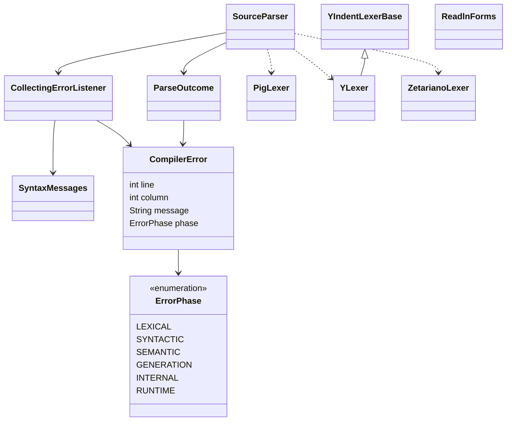

`ReadlnForms` reconoce, en el árbol de Zetariano, un `readln()` solitario para convertir la línea leída al tipo de la variable. Los parsers (`PigParser`, `YParser`, `ZetarianoParser`) los crea `SourceParser` junto a cada lexer.

### 4.3. Semántica de Zetariano (`semantic.analysis`, `semantic.symbols`, `semantic.types`)

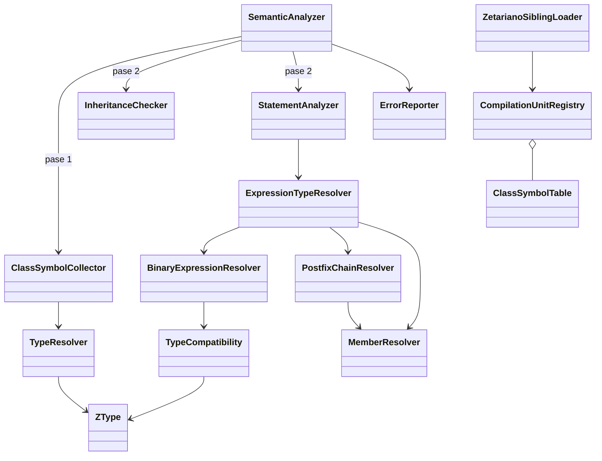

Clases de apoyo no dibujadas: `Scope` (ámbitos léxicos), `VariableSymbol`, `MethodSymbol`, `ConstructorSymbol`, `Visibility`, `ClassHierarchy` y `AccessRules` (búsqueda por la cadena de superclases y reglas de visibilidad), `OverloadResolver` (elección de la sobrecarga), `SwitchChecker`, `ArrayInitializerChecker`, `ArrayCreationResolver`, `ReturnFlowChecker` (retorno faltante y código inalcanzable), `SuperCallShape` y `PackagePaths`.

### 4.4. Semántica de Y? (`semantic.y.*`)

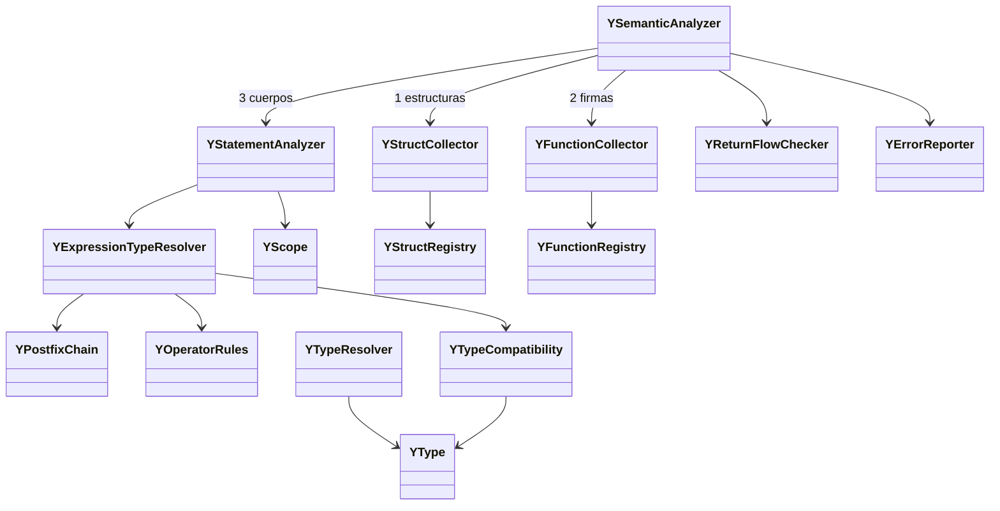

### 4.5. Semántica de Pig Latin e imports (`semantic.pig.*`)

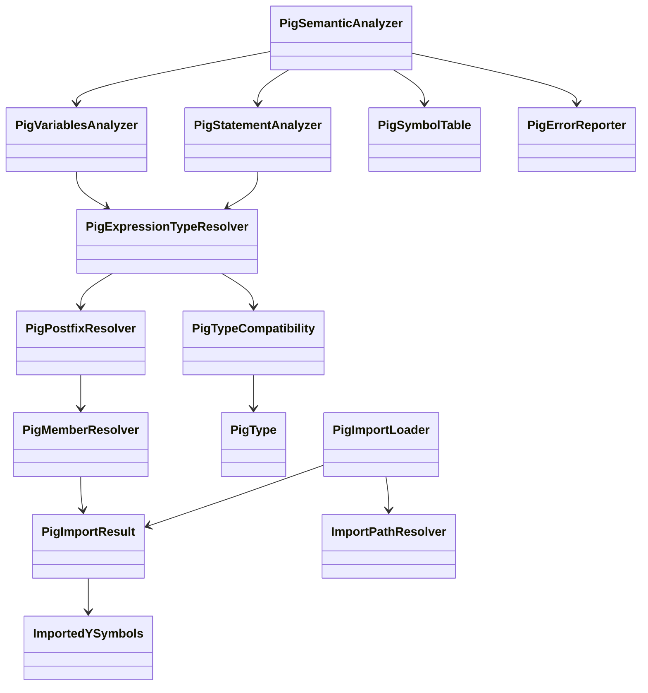

`PigImportLoader` parsea y valida cada `.y` y `.z` importado (reutilizando `YSemanticAnalyzer` y `SemanticAnalyzer`) y deja sus símbolos en `PigImportResult`, que a su vez conserva el `CompilationUnitRegistry` de las clases Zetariano.

### 4.6. Cuartetas y núcleo de generación (`codegen.quad`, `codegen.gen`)

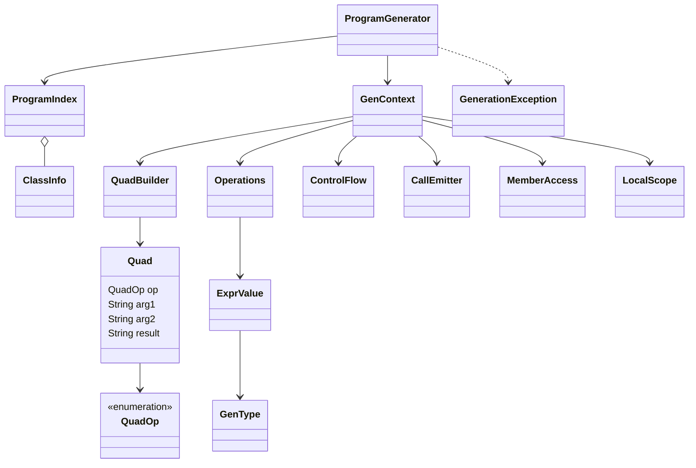

### 4.7. Generadores por lenguaje (`codegen.gen.pig`, `.y`, `.z`)

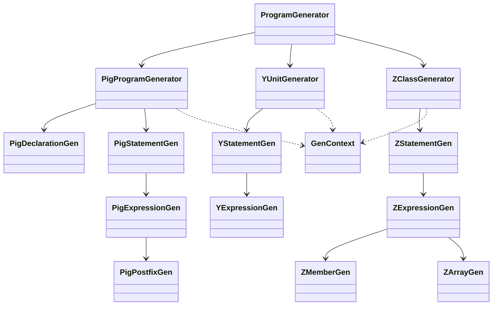

Cada lenguaje tiene además su `*TypeMapper` (tipo de la gramática → `GenType`). `YPostfixGen` resuelve campos, elementos y llamadas de Y?; `StructFormatter` produce el texto de una estructura al imprimirla.

### 4.8. Backend RISC-V (`codegen.riscv`)

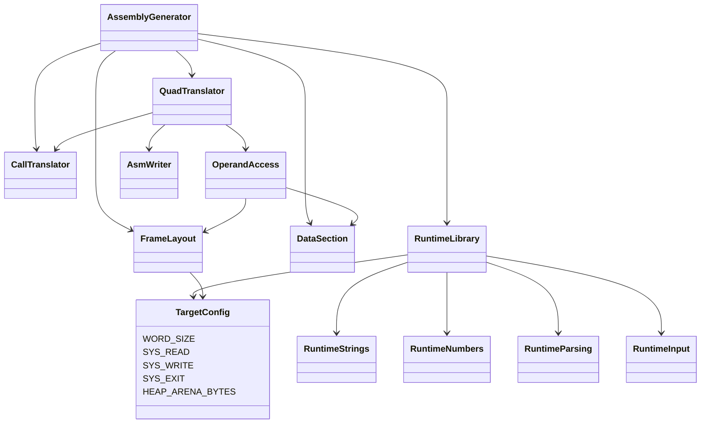

### 4.9. Ejecución por lotes (`codegen.exec`, `api.compile`)

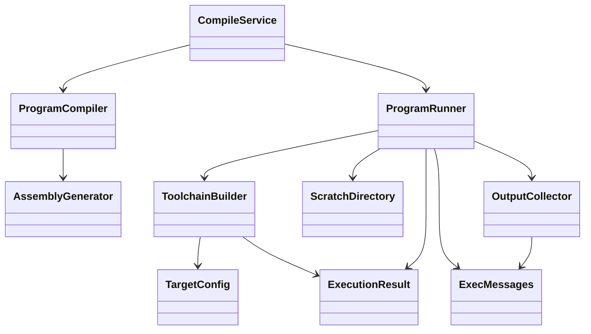

### 4.10. Ejecución interactiva (`api.run`, `codegen.exec.interactive`)

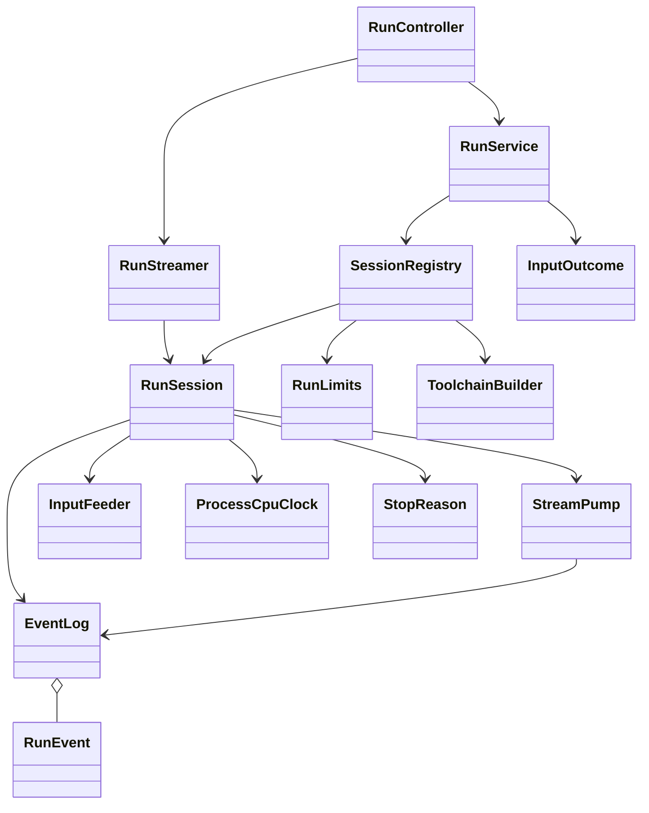

---

## 5. Palabras reservadas, símbolos y gramática

Las tablas se derivan de los lexers y parsers `.g4` (`backend/src/main/antlr4/.../grammar/`). En los tres lenguajes las palabras reservadas distinguen mayúsculas de minúsculas y no pueden usarse como identificadores. Los comentarios se envían al canal oculto: el tokenizador los entrega con `hidden: true` y el parser no los ve.

Archivos de referencia: `pig/PigLexer.g4`, `pig/PigParser.g4`, `y/YLexer.g4`, `y/YParser.g4`, `zetariano/ZetarianoLexer.g4`, `zetariano/ZetarianoParser.g4`.

### 5.1. Pig Latin (`.pig`)

**Palabras reservadas**

| Categoría | Tokens |
| :--- | :--- |
| Estructura | `import`, `esto`, `novus`, `series`, `null` |
| Tipos | `numerus`, `decimalis`, `textum`, `littera`, `bool` |
| Literales booleanos | `verum`, `falsus` |
| Condicional | `si`, `aliter`, `finis` |
| Ciclos y saltos | `dum`, `facere`, `per`, `perge`, `interrumpe` |
| Lógico | `non` |
| Marcadores de sección | `VARIABILES>`, `MAIOR>`, `FINIS` (cierre del programa, distinto de `finis`), `MUNERA>` (reservado: se rechaza con un mensaje, ver 10) |

**Símbolos**

| Tipo | Símbolos |
| :--- | :--- |
| Aritméticos | `+` `-` `*` `/` `%` `++` `--` |
| Relacionales | `==` `!=` `<` `>` `<=` `>=` |
| Lógicos | `&&` `\|\|` `!` (y la palabra `non`) |
| Entrada/salida | `>>` (imprimir), `<<` (leer) |
| Asignación | `=` |
| Delimitadores | `:` `;` `,` `.` `[` `]` `{` `}` `(` `)` |

**Literales y comentarios:** enteros `[0-9]+`; decimales `[0-9]+.[0-9]+`; caracteres `'a'`; cadenas `"..."` con escapes `\" \' \\ \n \t \r`; identificadores `[a-zA-Z_][a-zA-Z0-9_]*`. Comentario de línea `// ...` y de bloque `## ... ##`.

**Gramática resumida** (`PigParser.g4`)

```
programa      := import* variabilesSection? maiorSection EOF
import        := 'import' (ID '.')+ ID                       // import clases.Nodo.z  ->  clases/Nodo.z
variabilesSec := 'VARIABILES>' declaración*
declaración   := 'esto' ID ':' (tipo expr? | expr) ';'?                       // variable básica
               | 'series' ID '[' INT ']' ':' (tipo | ID) ('{' expr (',' expr)* '}')? ';'
               | 'esto' ID ':' ID ('{' expr (',' expr)* '}')? ';'?            // estructura Y?
               | 'esto' ID ':' 'novus' ID '(' args? ')' (':' ID)? ';'?        // objeto Zetariano
               | 'esto' ID ':' 'null' ':' ID ';'?
tipo          := numerus | textum | decimalis | littera | bool
maiorSection  := 'MAIOR>' sentencia+ 'FINIS' ';'
sentencia     := destino '=' expr ';'? | destino '<<' | '>>' expr ('>>' expr)* ';'?
               | 'si' '(' expr ')' '{' sent* '}' ('aliter' ('(' expr ')')? '{' sent* '}')* 'finis' ';'
               | 'dum' '(' expr ')' '{' sent* '}' 'finis' ';'
               | 'facere' '{' sent* '}' 'dum' '(' expr ')' ';'
               | 'per' '(' init? ';' expr? ';' expr? ')' '{' sent* '}'
               | 'perge' ';' | 'interrumpe' ';' | postfijo ';'?
init          := 'esto' ID ':' tipo expr | expr
expr          := asignación > || > && > (== !=) > (< > <= >=) > (+ -) > (* / %) > unario > postfijo
unario        := ('!' | 'non' | '-' | '+') unario | postfijo
postfijo      := primario ( '.' ID | '[' expr ']' | '(' args? ')' | '++' | '--' )*
primario      := INT | FLOAT | CHAR | STRING | verum | falsus | null | ID | '(' expr ')'
               | 'novus' ID '(' args? ')' | '{' expr (',' expr)* '}'
```

Notas: el `;` es opcional en declaraciones básicas, asignaciones e impresión, y obligatorio en los cierres estructurales (`finis;`, `FINIS;`, `facere {…} dum(…);`), en `series` y en la condición de `facere`. La declaración puede omitir el tipo si lleva una expresión (`esto x : 5;`, `esto b : falsus;`): el tipo se deduce de la expresión.

### 5.2. Y? (`.y`)

**Palabras reservadas**

| Categoría | Tokens |
| :--- | :--- |
| Estructura | `estructura`, `definir`, `retornar` |
| Tipos | `entero`, `cadena`, `flotante`, `caracter`, `bool` |
| Literales booleanos | `verdadero`, `falso` |
| Condicional | `si`, `entonces`, `sino`, `contrario` |
| Selección múltiple | `elegir`, `caso`, `siempre` |
| Ciclos y saltos | `para`, `mientras`, `hacer`, `romper`, `continuar` |
| Entrada/salida | `imprimir`, `leer` |
| Secciones | `%estructuras`, `%funciones` |

**Símbolos**

| Tipo | Símbolos |
| :--- | :--- |
| Aritméticos | `+` `-` `*` `/` `%` `++` `--` |
| Relacionales | `==` `!=` `<` `>` `<=` `>=` |
| Lógicos | `&&` `\|\|` `!` |
| Otros | `=` `->` (tipo de retorno) `:` `,` `.` `[` `]` `{` `}` `(` `)` `;` |
| Estructurales | `NEWLINE`, `INDENT`, `DEDENT` (los sintetiza `YIndentLexerBase` a partir de la sangría; al final del archivo emite el `NEWLINE` de la última línea si falta y luego los `DEDENT` pendientes) |

**Literales y comentarios:** enteros, flotantes `d+.d+`, caracteres, cadenas con escapes `\" \' \\ \n \t \r`. Comentarios `// línea` y `/* bloque */`.

**Gramática resumida** (`YParser.g4`)

```
programa      := NEWLINE* ('%estructuras' NEWLINE estructura*)? '%funciones' NEWLINE función+ EOF
estructura    := 'estructura' ID ':' NEWLINE INDENT (declaración NEWLINE | estructura)+ DEDENT
función       := 'definir' ID '(' params? ')' ('->' tipo)? ':' NEWLINE INDENT sentencia+ DEDENT
param         := tipo ID | ('[' ']')+ tipo ID | '{' '}' ID ID        // por valor | arreglo | estructura
tipo          := entero | cadena | flotante | caracter | bool | ID
declaración   := tipo ID ('[' INT ']')* ('=' expr)?
sentencia     := declaración ';'? NEWLINE | expr ';'? NEWLINE | estructura
               | 'retornar' expr? ';'? NEWLINE | 'romper' ';'? NEWLINE | 'continuar' ';'? NEWLINE
               | 'si' '(' expr ')' 'entonces' bloque ('sino' '(' expr ')' 'entonces' bloque)* ('contrario' bloque)?
               | 'elegir' '(' expr ')' ( '{' NEWLINE caso* siempre? '}' NEWLINE
                                       | ':' NEWLINE INDENT caso* siempre? DEDENT )
               | 'para' '(' init? ';' expr? ';' expr? ')' ':' bloque
               | 'mientras' '(' expr ')' (':' | 'hacer') bloque
               | 'hacer' ':' bloque 'mientras' '(' expr ')' NEWLINE
bloque        := NEWLINE INDENT sentencia+ DEDENT
caso          := 'caso' expr ':' NEWLINE (INDENT sentencia+ DEDENT | sentencia+)
siempre       := 'siempre' ':' NEWLINE (INDENT sentencia+ DEDENT | sentencia+)
expr          := asignación > || > && > (== !=) > (< > <= >=) > (+ -) > (* / %) > unario > postfijo
unario        := ('+' | '-' | '!' | '++' | '--') unario | postfijo
postfijo      := primario ( '.' ID | '[' expr ']' | '(' args? ')' | '++' | '--' )*
primario      := INT | FLOAT | CHAR | STRING | verdadero | falso | ID
               | 'imprimir' '(' args? ')' | 'leer' '(' args? ')' | '(' expr ')' | '{' expr (',' expr)* '}'
```

Notas: `elegir` y `mientras` aceptan dos formas (con llaves o `:`; con `:` o con `hacer`). Una sangría que no coincide con ningún bloque abierto se reporta como error léxico. Un tabulador cuenta como 4 espacios.

### 5.3. Zetariano (`.z`)

**Palabras reservadas**

| Categoría | Tokens |
| :--- | :--- |
| Clase y visibilidad | `public`, `private`, `protected`, `class`, `this` |
| Herencia | `extends`, `super`, `@Override` |
| Objetos | `new` |
| Tipos | `int`, `double`, `char`, `boolean`, `String`, `void` |
| Literales | `true`, `false`, `null` |
| Condicional | `if`, `else`, `switch`, `case`, `default` |
| Ciclos y saltos | `while`, `do`, `for`, `break`, `continue`, `return` |
| Entrada/salida | `println`, `print`, `readln` |

**Símbolos**

| Tipo | Símbolos |
| :--- | :--- |
| Aritméticos | `+` `-` `*` `/` `%` `++` `--` |
| Asignación | `=` `+=` `-=` `*=` |
| Relacionales | `==` `!=` `<` `>` `<=` `>=` |
| Lógicos | `&&` `\|\|` `!` |
| Otros | `?` `:` (ternario) y delimitadores `{` `}` `(` `)` `[` `]` `;` `,` `.` |

**Literales y comentarios:** enteros, decimales `d+.d+`, caracteres, cadenas con escapes `\" \' \\ \n \t \r`. Comentarios `// línea` y `/* bloque */`.

**Gramática resumida** (`ZetarianoParser.g4`)

```
clase         := 'public'? 'class' ID ('extends' ID)? '{' miembro* '}' EOF
miembro       := campo | constructor | método
campo         := vis? tipo ID ';'
constructor   := vis? ID '(' params? ')' bloque
método        := '@Override'? vis? (tipo | 'void') ID '(' params? ')' bloque
vis           := 'public' | 'private' | 'protected'          // sin modificador: acceso por defecto (paquete)
tipo          := (int | double | char | boolean | String | ID) ('[' ']')*
sentencia     := tipo ID ('=' (expr | inicializador))? ';' | expr ';' | bloque
               | 'if' '(' expr ')' stmt ('else' stmt)?
               | 'while' '(' expr ')' stmt | 'do' stmt 'while' '(' expr ')' ';'
               | 'for' '(' init? ';' expr? ';' (expr (',' expr)*)? ')' stmt
               | 'switch' '(' expr ')' '{' ('case' literal ':' sent* | 'default' ':' sent*)* '}'
               | 'return' expr? ';' | 'break' ';' | 'continue' ';'
               | 'println' '(' args? ')' ';' | 'print' '(' args? ')' ';'
inicializador := '{' (inicializador (',' inicializador)*)? '}' | expr
expr          := asignación (= += -= *=) > ternario (?:) > || > && > (== !=) > (< > <= >=) > (+ -) > (* / %) > unario > postfijo
unario        := ('+' | '-' | '!' | '++' | '--') unario | '(' (int|double|char) ')' unario | postfijo
postfijo      := primario ('++' | '--' | '.' ID | '[' expr ']' | '(' args? ')')*
primario      := INT | DOUBLE | CHAR | STRING | true | false | null | this | super | 'readln' '(' ')' | ID
               | 'new' tipoBase ('[' expr ']')+ | 'new' ID '(' args? ')' | '(' expr ')'
```

Notas: un archivo contiene una clase y su nombre debe coincidir con el del archivo. La herencia admite `extends` entre clases cualesquiera; `@Override` es obligatorio al sobrescribir (sección 9).

---

## 6. Tabla de compatibilidad de tipos

Fuentes: `TypeCompatibility` (Zetariano), `PigTypeCompatibility`, `YTypeCompatibility`, `BinaryExpressionResolver`, `YOperatorRules` y `PigExpressionTypeResolver`. Se usan nombres genéricos: **ENT** (`numerus`/`entero`/`int`), **DEC** (`decimalis`/`flotante`/`double`), **TXT** (`textum`/`cadena`/`String`), **CAR** (`littera`/`caracter`/`char`) y **BOOL** (`bool`/`bool`/`boolean`).

### 6.1. Equivalencia de tipos

| Pig Latin | Y? | Zetariano |
| :--- | :--- | :--- |
| `numerus` | `entero` | `int` |
| `decimalis` | `flotante` | `double` |
| `textum` | `cadena` | `String` |
| `littera` | `caracter` | `char` |
| `bool` (`verum`/`falsus`) | `bool` (`verdadero`/`falso`) | `boolean` (`true`/`false`) |
| `series nombre[n] : tipo` | `tipo nombre[n]` (N dimensiones) | `tipo[]` (N dimensiones) |
| estructura de un `.y` / objeto de un `.z` | nombre de estructura | nombre de clase |

### 6.2. Asignación `destino = origen`

✔ permitido, ✘ error semántico. La tabla es la misma en los tres lenguajes salvo donde se indica.

| Destino \ Origen | ENT | DEC | TXT | CAR | BOOL | Mismo objeto/estructura | `null` |
| :--- | :---: | :---: | :---: | :---: | :---: | :---: | :---: |
| ENT | ✔ | ✘ | ✘ | ✔ (por su código) | ✘ | ✘ | ✘ |
| DEC | ✔ (ensancha) | ✔ | ✘ | ✔ (por su código) | ✘ | ✘ | ✘ |
| TXT | ✘ | ✘ | ✔ | ✘ | ✘ | ✘ | ✔ solo Zetariano |
| CAR | ✘ | ✘ | ✘ | ✔ | ✘ | ✘ | ✘ |
| BOOL | ✘ | ✘ | ✘ | ✘ | ✔ | ✘ | ✘ |
| Objeto / estructura | ✘ | ✘ | ✘ | ✘ | ✘ | ✔ (misma clase; en Zetariano y Pig también una subclase) | ✔ objetos (Zetariano y Pig); ✘ en Y? |
| Arreglo | — | — | — | — | — | ✔ si coinciden tipo base y número de dimensiones | ✔ en Zetariano |

Un tipo desconocido (consecuencia de un error previo) es compatible con todo, para no encadenar errores. Los arreglos son invariantes: `Cuenta[]` no recibe `Ahorro[]`.

### 6.3. Operadores

| Operación | Operandos válidos | Resultado |
| :--- | :--- | :--- |
| `+` con algún TXT | TXT con cualquier tipo escalar (ENT, DEC, CAR, BOOL) o `null`; el otro operando se convierte a texto (`"a" + null` es `anull`). Un arreglo, un objeto o un valor `void` se rechaza | TXT (concatenación) |
| `+ - * /` numérico | ENT, DEC y CAR entre sí. En Pig, `-` y `*` y `/` siguen la misma regla | DEC si algún operando es DEC; si no, ENT. **Pig:** CAR con CAR da CAR; en Y? y Zetariano da ENT |
| `%` | ENT y CAR | ENT. Con DEC: error en Pig y en Y?. **Zetariano:** acepta DEC y da DEC con la semántica de Java: el resultado tiene el signo del dividendo (`-7.5 % 2.0` es `-1.50`) y un divisor `0.0` da `nan` (se imprime `nan`) |
| `-x` y `+x` unarios | ENT o DEC (en Zetariano también CAR, que pasa a ENT) | el mismo tipo |
| `++` `--` | operando numérico | el mismo tipo (en Zetariano, `++c` mantiene CAR) |
| `< > <= >=` | ENT, DEC y CAR entre sí (en los tres lenguajes) | BOOL |
| `== !=` | numérico con numérico (CAR cuenta como numérico en Zetariano y Pig); BOOL con BOOL; CAR con CAR; TXT con TXT; objeto o estructura con otra del mismo nombre; Zetariano y Pig: objetos de una misma jerarquía y `null` | BOOL |
| `&& \|\| !` (y `non` en Pig) | solo BOOL | BOOL |
| `?:` (Zetariano) | condición BOOL; ramas de tipos asignables entre sí | el tipo de la rama que acepta a la otra |
| `(int) (double) (char)` (Zetariano) | operando ENT, DEC o CAR | el tipo del cast |
| `+=` (Zetariano) | como `+`; con TXT solo si el destino es TXT | tipo del destino |
| `-= *=` (Zetariano) | numéricos | tipo del destino |

Las condiciones de `si`, `dum`, `per`, `if`, `while`, `for`, `mientras` y similares deben ser estrictamente BOOL: un número no es una condición.

### 6.4. Conversiones en la generación de código

- **Implícitas numéricas:** el entero (o el carácter) se promueve a decimal con la operación `I2F` cuando el otro operando, el destino de la asignación, un parámetro o el tipo de retorno es decimal. La conversión inversa (decimal → entero, `F2I`, truncando hacia cero) solo ocurre en una asignación compuesta sobre un destino entero (`x += 1.5`); fuera de eso, un decimal no entra en un entero sin cast.
- **A texto en la concatenación:** ENT → dígitos; CAR → el carácter; DEC → exactamente 2 decimales; BOOL → `verum`/`falsus` (Pig), `verdadero`/`falso` (Y?), `true`/`false` (Zetariano). Una estructura de Y? se imprime como `Nombre{campo=valor, ...}`.
- **Casts explícitos:** solo existen en Zetariano y solo entre `int`, `double` y `char` (`(int) 3.7` da `3`).
- **Igualdad de cadenas:** `==` y `!=` entre TXT comparan el contenido (operación `STR_EQ`).
- **Lectura:** `<<` (Pig), `leer()` (Y?) y `readln()` (Zetariano) convierten la línea leída al tipo del destino.
- **Llamadas:** se verifica la cantidad de argumentos y la compatibilidad de asignación de cada uno con su parámetro; las sobrecargas se resuelven en compilación por los tipos de los argumentos (primero coincidencia exacta, luego el menor ensanchamiento).

---

## 7. Pipeline de compilación

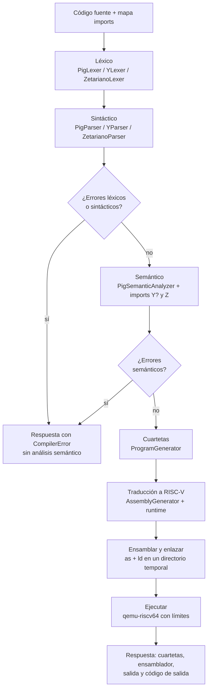

### 7.1. Análisis léxico

Cada lenguaje tiene su `*Lexer.g4`. Los comentarios van al canal `HIDDEN`. Y? usa `YIndentLexerBase`, que mantiene una pila de niveles de sangría y fabrica los tokens `INDENT` y `DEDENT`; una sangría que no coincide con ningún nivel abierto se reporta como error léxico. Una cadena o un comentario sin cerrar se reportan una sola vez y no encadenan errores sintácticos.

### 7.2. Análisis sintáctico

`SourceParser` es el único lugar que construye lexer y parser de cada lenguaje, con `CollectingErrorListener` en ambos, y devuelve un `ParseOutcome` (árbol y errores). `SyntaxMessages` convierte los reportes crudos de ANTLR en mensajes legibles (`Expected X but found Y`, `Unexpected end of file`). Un error léxico o sintáctico detiene el flujo: el árbol está incompleto y no se hace análisis semántico.

### 7.3. Análisis semántico

Las pasadas existen para que un símbolo pueda usarse antes de su declaración (una clase que usa otra declarada después, una función que llama a otra más abajo):

- **Zetariano** (`SemanticAnalyzer`): pase 1, `ClassSymbolCollector` registra campos, constructores y firmas en la `ClassSymbolTable`; pase 2, `InheritanceChecker` (superclase existente y sin ciclos, `@Override` válido, `super()` implícito) y `StatementAnalyzer` (cuerpos, ámbitos, tipos), más `ReturnFlowChecker` (retorno faltante y código inalcanzable). Las clases hermanas se cargan con `ZetarianoSiblingLoader` y se indexan en `CompilationUnitRegistry`; el paquete de una clase es la carpeta de su archivo.
- **Y?** (`YSemanticAnalyzer`): estructuras (`YStructCollector`), firmas de funciones (`YFunctionCollector`) y cuerpos (`YStatementAnalyzer`), con `YReturnFlowChecker`.
- **Pig Latin**: `PigImportLoader` procesa los `import` (cada `.y`/`.z` se parsea y valida por separado; sus símbolos se acumulan en `PigImportResult`); después `PigSemanticAnalyzer` valida `VARIABILES>` y `MAIOR>` contra esos símbolos. Los errores de un archivo importado llevan el prefijo `[archivo]`.

Los resolvers de expresiones devuelven un tipo por nodo (`ZType`, `YType`, `PigType`); los reporteros de errores acumulan todos los errores con la línea y la columna del nodo.

### 7.4. Cuartetas

`ProgramGenerator` parsea el `.pig` y sus imports (más los `.z` de la misma carpeta), construye un `ProgramIndex` con las firmas de funciones y la disposición de clases y estructuras, y recorre los árboles con visitors por lenguaje. Una cuarteta es `(op, arg1, arg2, result)` con las operaciones de `QuadOp`; los operandos son texto: literal entero (`5`), decimal (`#2.5`), cadena (`"hola"`), global (`@x`), variable o temporal (`t3`) y etiqueta (`L0`).

Ejemplo (programa Pig con un entero, un decimal y un `si`):

```
VARIABILES>
esto x : numerus 5;
esto r : decimalis 2.5;
MAIOR>
si (x > 3) {
    >> "x vale " >> x + 1;
} finis;
>> r * 2;
FINIS;
```

```
func pig_main:
@x = 5
@r = #2.5
t0 = @x > 3
if_false t0 goto L0
print_str "x vale "
t1 = @x + 1
print_int t1
print_nl
L0:
t2 = @r *. #2.0
print_float t2
print_nl
end pig_main
```

Al ejecutarlo imprime `x vale 6` y `5.00`. Los operadores decimales llevan un punto final (`*.`, `<.`); el `2` entero se convirtió al literal decimal `#2.0` en compilación (sin `I2F`, porque es una constante).

Objetos, herencia y arreglos (un `Perro` que extiende `Animal` y sobrescribe `sonido()`, importados por un programa Pig):

```
vtable class#1[0] = Animal__sonido__
vtable class#2[0] = Perro__sonido__
func pig_main:
t0 = new class#2 (16 bytes)
param t0
param 3
call Perro__new__I, 2
@p = t0
t1 = new array[3]
t1[0] = 1
...
t2 = @p.method[0]
param @p
t3 = call *t2, 1
print_str t3
end pig_main
func Perro__new__I:
recv this
recv e
param this
param e
call Animal__new__I, 2
end Perro__new__I
```

`new class#2 (16 bytes)` reserva el id de clase más un campo; `@p.method[0]` busca la ranura 0 de la tabla de métodos del objeto y `call *t2` es la llamada indirecta (despacho virtual). `Perro__new__I` es el constructor con un parámetro `int`; su `super(e)` implícito o explícito llama al constructor de `Animal` sobre el mismo objeto.

### 7.5. Traducción a RISC-V

`AssemblyGenerator` agrupa las cuartetas por función (`func`…`end`), calcula el marco de cada una (`FrameLayout`), traduce cada cuarteta (`QuadTranslator`, `CallTranslator`, `OperandAccess`) y agrega el runtime (`RuntimeLibrary`) y la sección de datos (`DataSection`). El programa arranca en `_start`, que inicializa el límite de pila, llama a `pig_main` y termina con `exit(0)`. Cada cuarteta aparece como comentario sobre las instrucciones que genera:

```
# t0 = @x > 3
    la t0, g_x
    ld t0, 0(t0)
    li t1, 3
    slt t0, t1, t0
    sd t0, -8(s0)
# if_false t0 goto L0
    ld t0, -8(s0)
    bnez t0, .L_skip0
    j .L_L0
.L_skip0:
```

La estrategia es deliberadamente uniforme: cada operación carga sus operandos en `t0`/`t1`, opera y guarda el resultado en la ranura de pila de su destino; no hay asignación de registros. Las ramas condicionales se emiten como un salto corto invertido sobre un `j`, porque una rama condicional alcanza solo ±4 KiB y `j` ±1 MiB.

**Marco de pila y llamadas.** El llamador reserva un bloque de argumentos (alineado a 16 bytes), guarda el argumento 0 en la dirección más baja, llama y libera el bloque. El resultado vuelve en `a0`. Los métodos reciben el objeto (`this`) como primer argumento.

```
 s0 + 16 + 8*i   parámetro i (lo empuja el llamador)
 s0 + 8          ra guardado
 s0 + 0          s0 del llamador guardado   <-- s0 apunta aquí
 s0 - 8*(k+1)    variable local o temporal número k
 ...             sp (alineado a 16)
```

Prólogo: `addi sp,sp,-16; sd ra,8(sp); sd s0,0(sp); mv s0,sp; sub sp,sp,<tamaño>` y comparación de `sp` con `stack_limit` (si se pasó, salta a `stack_overflow`). Epílogo: `mv sp,s0; ld ra; ld s0; addi sp,sp,16; ret`. Etiquetas: `pig_main`, `y_<función>`, `<Clase>__<método>__<códigos de tipo>` (los constructores usan el nombre `new`; la firma en la etiqueta distingue las sobrecargas).

**Palabra de máquina y valores.** Todo valor (entero, carácter, booleano, puntero a cadena, puntero a objeto) ocupa una palabra de 64 bits (`TargetConfig.WORD_SIZE`). Un decimal es el patrón IEEE-754 de un `double` guardado en una palabra; solo durante la operación se mueve a registros de coma flotante (`fmv.d.x`, `fadd.d`, `fmv.x.d`). Las comparaciones decimales dejan 0 o 1 en un registro entero; `I2F` es `fcvt.d.l` y `F2I` es `fcvt.l.d` con redondeo hacia cero.

**Heap.** El runtime reserva una arena de 128 MiB (`HEAP_ARENA_BYTES`) en `.bss` y un puntero `heap_ptr`. `alloc(bytes)` redondea a múltiplo de 8, avanza el puntero y devuelve el bloque (que ya está en ceros). Nada se libera; si la arena se agota se imprime `Out of memory` y el programa termina con código 12.

**Cadenas.** Registro `[longitud: 8 bytes][bytes]`, sin terminador. Los literales viven en `.rodata` con la longitud calculada al compilar y los literales iguales comparten registro; las cadenas dinámicas (`str_concat`, conversiones) se crean en el heap. Un puntero 0 (String sin valor) se imprime como `null`.

**Objetos.** Palabra 0 = identificador de clase; luego los campos de 8 bytes. Una subclase copia al inicio los campos de la superclase (mismos desplazamientos) y añade los suyos, de modo que un método heredado funciona sobre cualquier subclase. Una estructura de Y? tiene la misma forma con id 0. Leer un campo, o llamar a un método, de una referencia nula termina con `Null reference`: las llamadas por tabla fallan al leer la clase del objeto y las directas llevan antes la cuarteta `check_null` (no se emite cuando el receptor es `this`, ni en `super`).

**Tablas de métodos y herencia.** Cada clase con métodos tiene una tabla `vt_<id>` en `.rodata` con una dirección por ranura; sobrescribir un método reemplaza su ranura, y `class_table` guarda un puntero por id de clase. Una llamada es virtual (`LOAD_METHOD` + `CALL_INDIRECT`) solo si algún programa sobrescribe ese método; si no, es una llamada directa. `super.m()` y los métodos `private` se enlazan en compilación. El despacho virtual obtiene el id de la palabra 0 del objeto, indexa `class_table`, y toma la dirección de la ranura:

```
beqz t0, null_fail
ld t0, 0(t0)            # id de clase del objeto
slli t0, t0, 3
la t1, class_table
add t1, t1, t0
ld t1, 0(t1)            # tabla de esa clase
ld t0, ranura*8(t1)     # dirección del método
```

**Arreglos.** `[longitud][elemento 0][elemento 1]…` en el heap, una palabra por elemento, pasados por referencia. `array_new` reserva `(n+1)*8` bytes; `array_addr` valida el arreglo (nulo) y el índice con una comparación sin signo (que rechaza también los negativos) y falla con `Index out of bounds`. Los arreglos multidimensionales son arreglos de referencias a filas creadas con un bucle. Si el índice es constante y el tamaño declarado es conocido, el error se detecta antes, en el análisis semántico.

**Decimales.** Se imprimen siempre con exactamente 2 decimales (`|x|*100 + 0.5`, redondeo en la mitad); `NaN` e infinito se escriben `nan`, `inf`, `-inf`. La división decimal entre cero sigue IEEE (no es un error); la división o el módulo entero entre cero termina con `Division by zero`, porque en RISC-V la división entera por cero no lanza excepción y el divisor se comprueba antes.

**Syscalls.** Estilo Linux RV64 (número en `a7`, argumentos en `a0..a2`, instrucción `ecall`). Solo viven en `TargetConfig` y en el runtime:

| Syscall | Número | Uso |
| :--- | :---: | :--- |
| `read` | 63 | lectura de una línea de la entrada estándar (un byte por llamada, para no consumir de más) |
| `write` | 64 | escritura en salida estándar (fd 1) o error estándar (fd 2); se repite hasta escribir todo |
| `exit` | 93 | fin del programa |

No hay `ecall` de imprimir o leer enteros: la conversión número ↔ texto está en el propio runtime.

**Runtime** (texto ensamblador repartido en `RuntimeLibrary`, `RuntimeStrings`, `RuntimeNumbers`, `RuntimeParsing` y `RuntimeInput`):

| Rutina | Función |
| :--- | :--- |
| `exit`, `alloc`, `memcpy` | terminar, reservar memoria, copiar bytes |
| `write_bytes`, `print_str`, `print_nl`, `print_char`, `print_err` | escritura en stdout y stderr |
| `print_int`, `print_bool`, `print_float`, `int_to_str`, `char_to_str`, `bool_to_str`, `float_to_str`, `str_concat`, `str_eq` | conversión a texto, impresión, concatenación y comparación |
| `array_new`, `array_addr` | arreglos con verificación de límites |
| `read_line`, `read_int`, `read_float`, `read_char`, `str_to_int`, `str_to_float` | entrada estándar y conversión de texto a número |
| `div_zero`, `null_fail`, `array_fail`, `stack_overflow`, `alloc_fail` | errores de ejecución |

Los errores de ejecución se escriben por **error estándar** (fd 2):

| Situación | Mensaje | Código de salida |
| :--- | :--- | :---: |
| División o módulo entero entre 0 | `Division by zero` | 1 |
| Índice fuera de rango o arreglo nulo | `Index out of bounds` | 1 |
| Campo o método de una referencia nula | `Null reference` | 1 |
| Recursión sin fin | `Stack overflow` | 1 |
| Heap agotado | `Out of memory` | 12 |

### 7.6. Ensamblar, enlazar y ejecutar

`ToolchainBuilder` escribe el `.s` en un directorio temporal propio de la solicitud (`ScratchDirectory`), ejecuta `as` y `ld` y arma el comando del simulador. `ProgramRunner` (ejecución por lotes) lo corre con tiempo máximo, lee stdout y stderr con tope de tamaño (`OutputCollector`) y borra el directorio al terminar. Límites por defecto:

| Recurso | Límite | Cómo se aplica |
| :--- | :--- | :--- |
| Pila del programa | 64 MiB; el programa se detiene con `Stack overflow` al pasar los 60 MiB | bandera `-s 67108864` del simulador y `stack_limit` del prólogo |
| Heap | 128 MiB (arena en `.bss`) | `HEAP_ARENA_BYTES`; `Out of memory` y código 12 |
| Tiempo máximo | 10 s (`compiler.target.timeout-seconds`): de reloj en `/api/compile`, de CPU en `/api/run` | se mata el proceso; código 124 |
| Salida | 65536 bytes por flujo (`compiler.target.max-output-bytes`) | el exceso se descarta y se añade `[output truncated: the output limit was reached]` |

### 7.7. Respuesta de `/api/compile`

`{valid, errors, quadruples, assembly, stdout, stderr, exitCode}`. Con `valid: false` no se ejecutó nada y solo `errors` viene lleno. Si `as` o `ld` fallan, o alguna herramienta no está instalada, `exitCode` es `-1` y `stderr` trae el texto de la herramienta o el aviso de qué instalar; si se agota el tiempo, `exitCode` es `124`; si el simulador muere por una señal, el código es `128 + n`.

### 7.8. Ejecución interactiva (`/api/run`)

`/api/compile` ejecuta el programa completo y responde al final con la entrada precargada. Para programas que preguntan (calculadora, ahorcado, laberinto) la consola necesita lo contrario: ver la salida en cuanto se escribe, dejar el programa esperando y entregarle lo que el usuario teclea. Eso es una **sesión**:

- La **salida** viaja por SSE (`SseEmitter`, `text/event-stream`): una conexión `GET` larga por sesión, de servidor a cliente.
- La **entrada** viaja por peticiones `POST` cortas. SSE es de un solo sentido y un `POST` por línea es más simple que un WebSocket y no necesita dependencias.
- La sesión guarda un **registro de eventos** (`EventLog`) con número de orden. El stream lo reproduce desde el principio (o desde `Last-Event-ID`) y luego sigue en vivo, así que lo que el programa escribe antes de que el cliente conecte no se pierde.

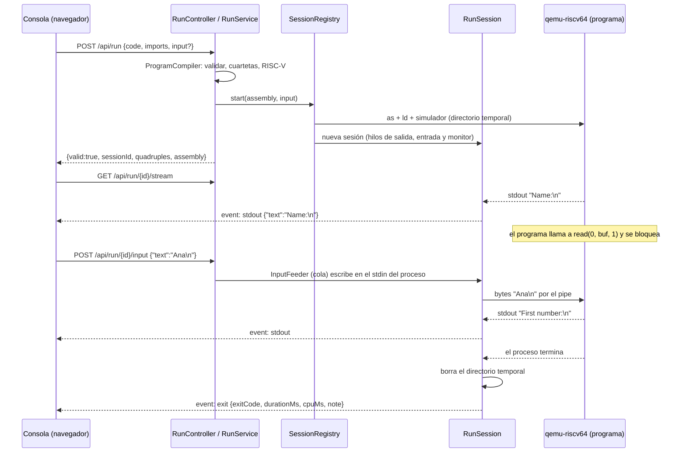

**Cómo llega la entrada.** `read_line` ejecuta la syscall `read` sobre el descriptor 0, un byte por llamada. `qemu-riscv64` la traduce a un `read` real sobre su stdin, que es el pipe abierto por Java. Mientras el pipe esté vacío, `read` bloquea el proceso sin consumir CPU; cuando `InputFeeder` escribe, despierta. Cerrar el stdin hace que `read` devuelva 0: es el fin de entrada que ve el programa.

**Hilos de una sesión** (virtuales): uno copia stdout, otro stderr (`StreamPump`, decodificación UTF-8 incremental y tope de bytes), uno escribe la entrada (`InputFeeder`) y uno vigila el proceso cada 200 ms (`RunSession`). El de stderr retrasa 10 ms lo que lee para que un mensaje de error no se adelante al texto escrito justo antes por stdout.

**Límites.** El tope de ejecución es de **tiempo de CPU**, no de reloj: cada 200 ms se lee `utime + stime` del proceso en `/proc/<pid>/stat` (`ProcessCpuClock`). Un programa bloqueado esperando al usuario no gasta CPU, así que esperar no cuenta.

| Límite | Valor por defecto | Propiedad | Qué ocurre al cumplirse |
| :--- | :---: | :--- | :--- |
| CPU del programa | 10 s | `compiler.target.timeout-seconds` | se mata; `exit` con código 124 y nota "CPU time limit exceeded" |
| Duración total de la sesión | 600 s | `compiler.run.wall-seconds` | se mata; código 124 |
| Inactividad (sin salida ni entrada) | 300 s | `compiler.run.idle-seconds` | se mata; código 124 |
| Sin consola conectada | 5 s | `compiler.run.detach-grace-seconds` | se mata; código 143 |
| Sesiones simultáneas | 5 | `compiler.run.max-sessions` | `POST /api/run` responde 429 |
| Entrada pendiente de leer | 16 KiB | `compiler.run.max-pending-input-bytes` | `POST .../input` responde 413 |
| Salida por flujo | 64 KiB | `compiler.target.max-output-bytes` | el resto se descarta y se avisa con un evento `system` |
| Sesión terminada, conservada | 30 s | `compiler.run.finished-retention-seconds` | después de ese plazo el id deja de existir (404) |

El cliente que se desconecta se detecta porque el stream envía un comentario SSE (`: keepalive`) cada 3 s y esa escritura falla. Al apagar el backend se detienen todas las sesiones. El directorio temporal se borra al terminar el proceso; solo una muerte forzada del backend (`kill -9`) puede dejar uno atrás.

**Códigos de salida de una sesión:** el del programa tal cual (0; 1 error de ejecución; 12 memoria agotada; `128 + n` si lo mata una señal, con nota); 124 si lo cortó un límite; 143 si se detuvo desde fuera (botón Stop, desconexión, apagado).

---

## 8. Referencia de la API

El `Content-Type` de las peticiones es `application/json`. Los endpoints de tokenize, validate y compile responden siempre HTTP 200: un error en el código fuente no es un error HTTP, se informa con `valid: false` y una lista de errores. `/api/run` añade códigos propios (404, 409, 413, 429).

El campo `language` es exactamente `"pig"`, `"y"` o `"zetariano"`. Las claves de `imports` son rutas relativas con barras (`"clases/Nodo.z"`).

### 8.1. `POST /api/tokenize`

Solo análisis léxico. Devuelve todos los tokens (incluidos los ocultos, como los comentarios) y los errores léxicos. Alimenta el coloreado del editor.

```json
{ "code": "esto x : numerus 10; // inicial", "language": "pig" }
```

```json
{
  "tokens": [
    { "type": "ESTO", "text": "esto", "line": 1, "startColumn": 0, "endColumn": 4, "hidden": false },
    { "type": "LINE_COMMENT", "text": "// inicial", "line": 1, "startColumn": 22, "endColumn": 32, "hidden": true }
  ],
  "lexicalErrors": []
}
```

`line` cuenta desde 1; `startColumn` y `endColumn` cuentan desde 0 (`endColumn` es exclusivo) y delimitan el token en su línea. Un lenguaje desconocido produce un error de fase `INTERNAL` (ver 8.6).

### 8.2. `POST /api/validate`

Léxico, sintáctico y semántico de un archivo, resolviendo sus imports (Pig) o sus clases hermanas (Zetariano) desde el mapa `imports`.

```json
{
  "code": "import clases.Nodo.z\nVARIABILES>\nesto n : novus Nodo();\nMAIOR>\nFINIS;",
  "language": "pig",
  "imports": { "clases/Nodo.z": "public class Nodo { int dato; }" },
  "path": "main.pig"
}
```

`path` es opcional; indica dónde está el archivo para calcular su paquete (su carpeta). Respuesta:

```json
{ "valid": false,
  "errors": [ { "line": 7, "column": 1, "message": "Variable 'y' is not declared", "phase": "SEMANTIC" } ] }
```

### 8.3. `POST /api/compile`

Valida y, si no hay errores, genera cuartetas y RISC-V, ensambla, enlaza, ejecuta hasta el final y devuelve la salida. Solo acepta `"language": "pig"`; Y? y Zetariano se compilan como archivos importados. La entrada completa va en `input`.

```json
{ "code": "MAIOR>\n>> \"Hola\";\nFINIS;", "language": "pig", "imports": {}, "input": "" }
```

```json
{
  "valid": true,
  "errors": [],
  "quadruples": [
    { "op": "FUNC_BEGIN", "arg1": null, "arg2": null, "result": "pig_main", "text": "func pig_main:" },
    { "op": "PRINT_STR", "arg1": "\"Hola\"", "arg2": null, "result": null, "text": "print_str \"Hola\"" },
    { "op": "PRINT_NL", "arg1": null, "arg2": null, "result": null, "text": "print_nl" },
    { "op": "FUNC_END", "arg1": null, "arg2": null, "result": "pig_main", "text": "end pig_main" }
  ],
  "assembly": "# Generated RISC-V (RV64) program\n    .text\n ...",
  "stdout": "Hola\n",
  "stderr": "",
  "exitCode": 0
}
```

Con un programa inválido: `{"valid": false, "errors": [...], "quadruples": [], "assembly": null, "stdout": null, "stderr": null, "exitCode": null}`. Para otros lenguajes distintos de `pig`, el error es de fase `GENERATION` (`Only Pig Latin programs can be compiled to RISC-V`).

### 8.4. `/api/run` (ejecución interactiva con SSE)

**`POST /api/run`** — mismo cuerpo que `/api/compile`; `input` es opcional (si viene, esas líneas se envían al arrancar y la sesión sigue abierta, sin fin de entrada).

```json
{ "valid": true, "errors": [], "sessionId": "5f0c…", "quadruples": [ ], "assembly": "…" }
```

Si el código no es válido responde `valid: false` con `errors`, sin `sessionId`, y no crea sesión. Si `as` o `ld` fallan con un programa válido, `valid: false` con un error de fase `INTERNAL` y, para depurar, las cuartetas y el ensamblador. Con 5 sesiones en curso responde **429**.

**`GET /api/run/{id}/stream`** — `text/event-stream`. Cada evento lleva `id:` (orden desde 0), `event:` y `data:` JSON:

```
id:0
event:stdout
data:{"text":"Name:\n"}

id:7
event:stderr
data:{"text":"Division by zero\n"}

id:9
event:exit
data:{"exitCode":0,"durationMs":832,"cpuMs":4,"note":null}
```

| Evento | Datos | Significado |
| :--- | :--- | :--- |
| `stdout` | `{text}` | fragmento de salida estándar, tal como llegó (puede acabar a media línea) |
| `stderr` | `{text}` | fragmento de error estándar (incluye los errores de ejecución) |
| `system` | `{text}` | aviso del servidor, por ejemplo que se alcanzó el límite de salida |
| `exit` | `{exitCode, durationMs, cpuMs, note}` | último evento; `durationMs` es tiempo de reloj y `cpuMs` el CPU de la última muestra (cada 200 ms); `note` explica un fin por límite, parada o señal |

Una conexión nueva con la cabecera `Last-Event-ID: n` continúa desde el evento `n + 1`. Los comentarios `: keepalive` cada 3 s no son eventos. Un id desconocido o vencido responde **404**.

**`POST /api/run/{id}/input`** — `{ "text": "Ana\n", "eof": false }`. Ambos campos son opcionales; `text` se envía tal cual (la consola añade el salto de línea) y `eof: true` cierra la entrada después del texto. Respuestas: **204** aceptado; **404** sesión desconocida; **409** el programa ya terminó o la entrada ya estaba cerrada; **413** hay demasiada entrada sin leer.

**`POST /api/run/{id}/stop`** — **204**. Es idempotente; el `exit` posterior trae código 143 y la nota "Execution stopped by the user".

Los errores de estos endpoints (404, 409, 413, 429) llevan el cuerpo estándar `{ "valid": false, "errors": [{ "line": 1, "column": 1, "message": "…", "phase": "RUNTIME" }] }`.

### 8.5. CORS

`CorsConfig` habilita las rutas `/api/**` solo para el origen `http://localhost:5173` (servidor de desarrollo de Vite), con los métodos `GET`, `POST` y `OPTIONS` y cualquier cabecera. Para otro origen hay que cambiar `CorsConfig` (la lista de orígenes permitidos está escrita allí) y reiniciar el backend.

### 8.6. Formato de errores

Todo error se transporta como `CompilerError`:

```json
{ "line": 12, "column": 8, "message": "Variable 'y' is not declared", "phase": "SEMANTIC" }
```

- **`line` y `column` cuentan desde 1** en todas las fases. ANTLR cuenta la columna desde 0; `CollectingErrorListener` le suma 1 en un único punto. Los errores semánticos y de generación toman la posición del token inicial del nodo del árbol.
- **Ninguna excepción llega como HTTP 500.** `GlobalExceptionHandler` convierte cualquier excepción en `valid: false` con un error de fase `INTERNAL` y un mensaje fijo (`Internal compiler error while analyzing the source`, o `Malformed or unreadable request body` si el JSON no se puede leer); la traza completa va solo al log.
- Todos los mensajes de error del compilador están en inglés.

---

## 9. Catálogo de errores

Los mensajes de los ejemplos son los reales del compilador. Cada error sale con `line`, `column` (desde 1) y `phase`.

### 9.1. `LEXICAL`

Un carácter, literal o comentario que ningún token reconoce.

| Ejemplo mínimo | Mensaje |
| :--- | :--- |
| `esto s : textum @;` (Pig) | `Unexpected character '@'` |
| `esto s : textum "abc` (cualquier lenguaje) | `Unclosed string literal: the closing quote is missing before the end of the line` |
| `'ab'` | `Invalid character literal: write exactly one character between single quotes` |
| `/* sin cerrar` (Y?, Zetariano) | `Unclosed comment: the closing mark is missing before the end of the file` |
| Y?: una línea con sangría que no coincide con ningún bloque abierto | `Indentation does not match any open block level` |

### 9.2. `SYNTACTIC`

El programa no cumple la gramática. El mensaje nombra lo encontrado y, si son pocas, lo esperado.

| Ejemplo mínimo | Mensaje |
| :--- | :--- |
| Pig sin `FINIS;` al final | `Unexpected end of file` |
| Zetariano: `public void g( { }` | `Unexpected '{'` |
| Y?: el archivo empieza con `estructura` en vez de `%estructuras` | `Expected '%estructuras', '%funciones' or end of line but found 'estructura'` |
| Y?: `romper` con sangría menor que la función | `Expected end of file or 'definir' but found 'romper'` |
| Pig: `MUNERA>` | `Pig Latin does not define functions; declare them in an imported .y file` |

### 9.3. `SEMANTIC`

| Categoría | Ejemplo mínimo | Mensaje |
| :--- | :--- | :--- |
| Símbolo no declarado | Pig: `>> y;` sin declarar `y` | `Variable 'y' is not declared` |
| Duplicado | Pig: `esto a : numerus 1;` dos veces | `Variable 'a' is already declared` |
| Tipos en asignación | Pig: `x = t;` con `x` numerus y `t` textum | `Cannot assign a value of type textum to a target of type numerus` |
| Tipos en inicialización | Pig: `esto n : numerus 1.5;` | `Cannot initialize variable 'n' of type numerus with a value of type decimalis` |
| Operador inválido | Pig: `x - t` con `t` textum | `Operator '-' cannot be applied to numerus and textum` |
| Condición | Pig: `si (n) {...} finis;` con `n` numerus | `Condition must be of type bool, found numerus` |
| Salto fuera de ciclo | Pig: `perge;` en `MAIOR>` | `'perge' can only be used inside a loop (dum, facere or per)` |
| Retorno faltante | Y?: `si` sin `retornar` en el otro camino | `Missing return: function 'f' must return a value on every path` |
| Retorno con tipo erróneo | Zetariano: `return "a";` en un método `int` | `Cannot return value of type 'string'; expected 'int'` |
| Inicialización con tipo erróneo | Zetariano: `int y = 2.5;` | `Cannot initialize variable 'y' of type 'int' with value of type 'double'` |
| Herencia | subclase que sobrescribe sin `@Override` | `Method 'f' overrides the method 'f' of class 'A' and must be annotated with @Override` |
| Import | Pig: `import Falta.y` sin enviar el archivo | `Imported file not found: Falta.y` |
| Aridad | Zetariano: `f(1, 2)` si `f` recibe un parámetro | `Method 'f' called with 2 argument(s), but no overload with that many parameters exists` |
| Acceso | subclase que usa un campo `private` de su superclase | `Field 'x' is private to class 'P' and cannot be used from class 'Q'` |
| Acceso | subclase que usa un campo de acceso por defecto de su superclase | `Field 'd' has default access in class 'P' and cannot be used from its subclass 'Q'` |
| Destino de asignación | Zetariano: `f() = 3;`, `(a) = 3;`, `5++;` | `The left side of '=' must be a variable, a field or an array element` / `Operand of '++' must be a variable, a field or an array element` (Pig y Y? tienen sus equivalentes) |
| Valor no imprimible | Zetariano: `println(arreglo);`, `"x" + objeto`, `println(metodoVoid());` | `Cannot print a value of type 'int[]'; print its fields or elements one by one` / `Cannot concatenate a value of type 'void' to a String; ...` |
| Literal entero fuera de rango | `99999999999999999999` en cualquier lenguaje | `Integer literal out of range: 99999999999999999999` |
| Tamaño de arreglo fuera de rango | `series[numerus : 99999999999]`, `entero v[99999999999]` | `Array size out of range: 99999999999` |
| `leer()` encadenado | Y?: `leer().campo` | `The value read by leer() is not a structure or an array; store it in a variable first` |
| Flujo | código tras `return` o `retornar` | `Unreachable code: the previous statement never lets execution continue` |

Un archivo importado con errores léxicos o sintácticos no recibe análisis semántico; sus errores llevan el prefijo `[archivo]`.

### 9.4. `GENERATION`

Reservada para algo que el análisis aceptó y el generador no puede traducir (`<característica> is not supported yet`) y para `Only Pig Latin programs can be compiled to RISC-V`. El análisis semántico rechaza antes todo lo que el generador no traduce, así que un programa que `/api/validate` acepta no debe terminar aquí; si ocurre, es un defecto del compilador.

### 9.5. `INTERNAL`

Fallo inesperado dentro del compilador (o un valor de `language` desconocido): mensaje fijo `Internal compiler error while analyzing the source`, posición `1:1`.

### 9.6. `RUNTIME`

Solo en `/api/run`: límite de sesiones (`Too many programs are running at the moment. Stop one or try again shortly.`), sesión desconocida o vencida (`The run session does not exist or has expired.`), entrada rechazada (`The program has already finished, so it cannot receive input.`, `The input of this program was already closed.`, `The program has not read the input already sent; wait before sending more.`).

Los errores que ocurren **mientras corre el programa** (división entre cero, índice fuera de rango, referencia nula, pila o heap agotados) no son `CompilerError`: salen por `stderr` con los mensajes de la sección 7.5 y su código de salida.

---

## 10. Limitaciones conocidas y supuestos

**Compilación y ejecución**

- `/api/compile` y `/api/run` solo aceptan Pig Latin como punto de entrada. Y? y Zetariano se compilan como archivos importados (o como clases de la misma carpeta) y no pueden ejecutarse solos.
- Se generan todos los `.y` y `.z` alcanzables; una función o clase con una construcción no traducida hace fallar la compilación aunque nadie la llame.
- Lo que el generador no traduce se rechaza en el análisis semántico, con su línea y columna: imprimir o concatenar un objeto o un arreglo completos (se imprimen sus campos o elementos uno a uno; las estructuras de Y? sí se imprimen), leer con `<<` sobre un objeto o un arreglo completos, valores `void` usados como dato, y destinos de asignación que no son variable, campo o elemento.
- El operador `%` con decimales solo existe en Zetariano (semántica de Java); en Pig y en Y? se rechaza en el análisis.
- Las estructuras anidadas de Y? se registran como estructuras independientes con su propio nombre.
- La memoria nunca se libera (`alloc` solo avanza el puntero): un programa que reserve más de 128 MiB termina con `Out of memory` y código 12.
- Los enteros son de 64 bits con aritmética modular (sin detección de desbordamiento).
- `decimalis`/`double` se imprime siempre con exactamente 2 decimales (redondeo hacia arriba en la mitad). Es un supuesto del proyecto para unificar el formato en los tres lenguajes.
- La división entera trunca hacia cero. `&&` y `||` hacen cortocircuito y los operandos se evalúan de izquierda a derecha.
- La igualdad `==` entre cadenas compara el contenido en los tres lenguajes (la semántica de Java compararía referencias).
- Un tabulador en Y? equivale a 4 espacios.
- El formato del archivo no cambia el resultado en ningún lenguaje: da igual que falte el salto de línea final (también tras bloques anidados, un comentario o líneas en blanco), que los saltos sean `\r\n`, que haya espacios al final de las líneas o que el archivo empiece con la marca BOM de UTF-8 (los léxicos la tratan como espacio).

**Lenguajes**

- Pig Latin no define funciones propias: `MUNERA>` (de la práctica 1) no se implementa porque el Proyecto 1 establece que las funciones vienen de archivos `.y`. Pig tampoco tiene casts.
- El tipo de `leer()` en Y? es desconocido durante el análisis (se acepta en cualquier primitivo); su tipo real lo fija el destino (declaración, asignación, argumento o `retornar`) y, sin destino, es entero. Por eso `leer() + 1` no reclama.
- Un miembro de acceso por defecto (`default`, sin modificador) de una superclase no puede usarse desde su subclase (error semántico), aunque estén en la misma carpeta. Desde una clase de la misma carpeta que no es subclase sí es visible. Desde Pig se ve todo salvo lo `private`; un `protected` se trata como `default`.
- Una clase Zetariano hereda de cualquier otra clase accesible; no hay interfaces, clases abstractas, clases anidadas ni genéricos.
- Los arreglos de Y? son de tamaño fijo declarado; los de Pig (`series`) tienen longitud mínima 1 y el índice debe ser `numerus`.

**Entorno**

- La cadena `as`/`ld`/`qemu-riscv64` debe estar instalada en la máquina del backend; si falta, `/api/compile` devuelve `exitCode: -1` y `/api/run` un error de fase `INTERNAL`, ambos con un mensaje que nombra la herramienta y el paquete por instalar (por ejemplo `The simulator 'qemu-riscv64' is not installed or is not on the PATH. Install it (Debian/Ubuntu: sudo apt install qemu-user) or set compiler.target.simulator in application.properties.`), con HTTP 200 y sin traza.
- Las sesiones interactivas viven en memoria: si el backend se reinicia, se pierden.
- El orden entre `stdout` y `stderr` en el stream es aproximado: son dos tuberías distintas y el servidor retrasa 10 ms el error estándar; no hay garantía formal.
- CORS permite únicamente `http://localhost:5173` (sección 8.5).
- Spike con `pk` no está instalado ni probado.

---

## 11. Instalación y ejecución

### 11.1. Requisitos

| Componente | Detalle |
| :--- | :--- |
| JDK | Java 21 o superior (`java -version`) |
| Maven | No hace falta instalarlo: el repositorio incluye el wrapper `./mvnw` |
| Binutils de RISC-V | `riscv64-linux-gnu-as` y `riscv64-linux-gnu-ld` |
| Simulador | `qemu-riscv64` (paquete `qemu-user`) |
| Sistema operativo | Linux (la medición de CPU de las sesiones lee `/proc/<pid>/stat`) |

En Debian o Ubuntu:

```bash
sudo apt install openjdk-21-jdk binutils-riscv64-linux-gnu qemu-user
```

Comprobación:

```bash
riscv64-linux-gnu-as --version
riscv64-linux-gnu-ld --version
qemu-riscv64 --version
```

### 11.2. Compilar y arrancar

Desde `backend/`:

```bash
./mvnw clean package        # genera los parsers ANTLR, compila y ejecuta las pruebas
./mvnw spring-boot:run      # arranca la API en http://localhost:8080
```

El puerto es el predeterminado de Spring Boot (8080). Para otro puerto: `./mvnw spring-boot:run -Dspring-boot.run.arguments=--server.port=8091`. El frontend apunta al backend con la variable `VITE_API_BASE_URL` (ver su documentación).

También puede ejecutarse el JAR generado: `java -jar target/contacto-alien-backend-0.0.1-SNAPSHOT.jar`.

### 11.3. Configuración (`src/main/resources/application.properties`)

| Propiedad | Valor por defecto | Significado |
| :--- | :--- | :--- |
| `compiler.target.assembler` | `riscv64-linux-gnu-as` | comando del ensamblador |
| `compiler.target.assembler-flags` | `-march=rv64imafdc` | banderas del ensamblador |
| `compiler.target.linker` | `riscv64-linux-gnu-ld` | comando del enlazador |
| `compiler.target.linker-flags` | `-static` | banderas del enlazador |
| `compiler.target.simulator` | `qemu-riscv64` | comando del simulador |
| `compiler.target.simulator-flags` | `-s,67108864` | banderas del simulador (pila de 64 MiB; debe coincidir con `TargetConfig.STACK_SIZE_BYTES`) |
| `compiler.target.timeout-seconds` | `10` | tiempo máximo (CPU en sesiones, reloj en `/api/compile`) |
| `compiler.target.max-output-bytes` | `65536` | salida máxima por flujo |
| `compiler.run.max-sessions` | `5` | sesiones interactivas simultáneas |
| `compiler.run.wall-seconds` | `600` | duración total de una sesión |
| `compiler.run.idle-seconds` | `300` | inactividad máxima |
| `compiler.run.detach-grace-seconds` | `5` | plazo sin consola conectada |
| `compiler.run.finished-retention-seconds` | `30` | cuánto se conserva una sesión terminada |
| `compiler.run.max-pending-input-bytes` | `16384` | entrada enviada y aún no leída |

Las constantes de plataforma (tamaño de palabra, números de syscall, tamaño del heap, presupuesto de pila) no son propiedades: están en `TargetConfig` y requieren recompilar.

### 11.4. Pruebas

El módulo incluye `ContactoAlienBackendApplicationTests` en `backend/src/test/java/.../`, una prueba de arranque de Spring (`contextLoads`) que comprueba que el contexto de la aplicación, con sus controladores y propiedades, se construye correctamente. Se ejecuta con `./mvnw test`. La validación del compilador se hace de extremo a extremo contra los endpoints `/api/validate` y `/api/compile` con programas de ejemplo en los tres lenguajes.
